<p><picture><source media="(max-width: 600px)" srcset="assets/readme/hero-mobile.svg"/>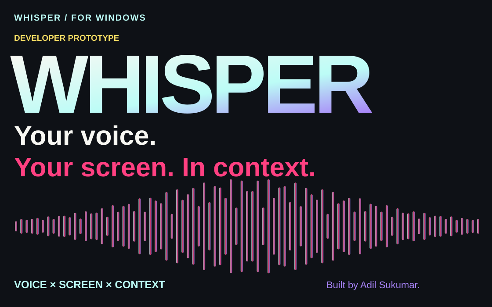</picture></p>

<p align="center"><a href="#what-whisper-does">Overview</a> · <a href="#current-status">Current status</a> · <a href="#developer-setup">Developer setup</a> · <a href="#documentation">Documentation</a></p>

Whisper is my Windows-native assistant for asking questions about the software in front of you. It brings voice or text input together with consented screen context, spoken answers and on-screen guidance.

**Status: local developer build.** This repository is a working prototype, with important release requirements still open. It is not a commercial release or a finished, one-click installer.

##  What Whisper does

<p><picture><source media="(max-width: 600px)" srcset="assets/readme/capabilities-mobile.svg"/>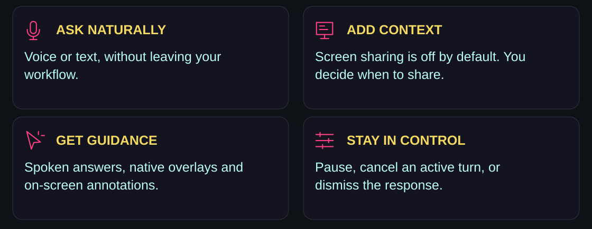</picture></p>

<p><picture><source media="(max-width: 600px)" srcset="assets/readme/flow-mobile.svg"/>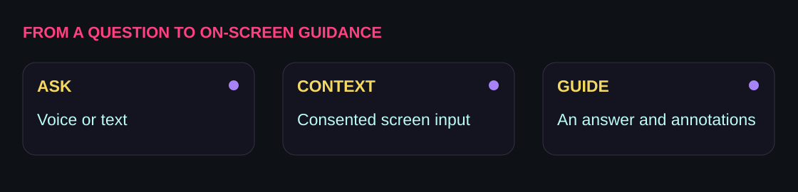</picture></p>

##  Current status

<p><picture><source media="(max-width: 600px)" srcset="assets/readme/status-mobile.svg"/>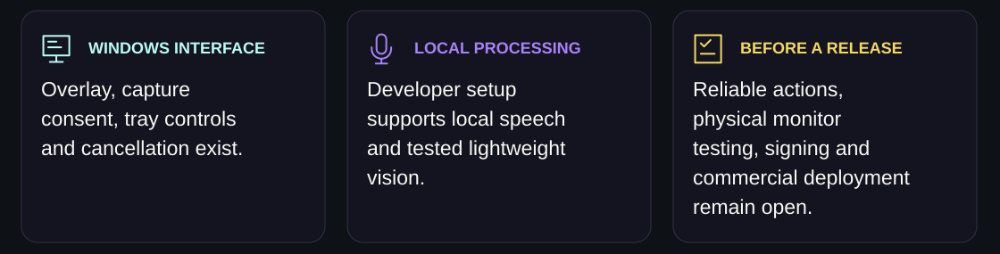</picture></p>

<details>
<summary><strong>Detailed status and verification</strong></summary>

| Area | Current developer-build status |
| --- | --- |
| Windows interface | Native overlay, tray controls and prototype hotkeys exist. |
| Screen context | Consented monitor capture and mixed-DPI coordinate handling exist; physical multi-monitor testing remains open. |
| Local processing | Local speech-to-text, text-to-speech and tested lightweight vision are available in the developer setup. |
| Turn control | Cancellation and pause/resume behavior are implemented. |
| Reliable action execution | Still a release requirement, alongside accessibility/OCR-first context. |
| Accounts and billing | Separate accounts work exists; live Google/billing deployment and desktop commercial enforcement remain release requirements. |
| Distribution | Signed installer and a complete end-user installation experience remain open. |

</details>

See the [release-status document](docs/25-release-status-and-account-enforcement.md) and [verification guide](docs/23-vision-and-desktop-verification.md) for the detailed evidence and remaining work.

##  Under the hood

<p><picture><source media="(max-width: 600px)" srcset="assets/readme/architecture-mobile.svg"/>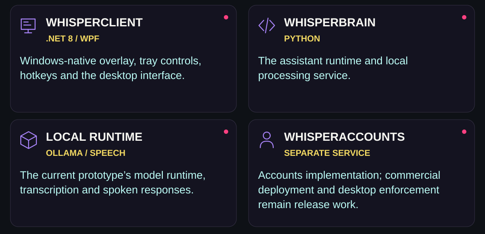</picture></p>

See the [accounts-service README](WhisperAccounts/README.md) for its implementation and release limitations.

##  Developer setup

<p><picture><source media="(max-width: 600px)" srcset="assets/readme/environment-mobile.svg"/>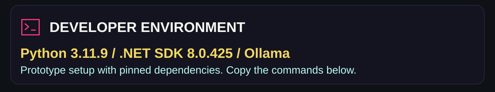</picture></p>

Prerequisites currently include .NET 8, Python, and Ollama. These are prototype requirements and must not become end-user setup requirements.

```powershell
python -m venv .venv
.\.venv\Scripts\python.exe -m pip install -r .\WhisperBrain\requirements.lock.txt
.\.venv\Scripts\python.exe -m pip install -r .\WhisperAccounts\requirements.lock.txt

# Optional voice transcription runtime (downloads the configured model on first use).
.\.venv\Scripts\python.exe -m pip install -r .\WhisperBrain\requirements.stt.txt

# Current prototype models; review size/license before downloading.
$env:OLLAMA_HOST='127.0.0.1:11435'
ollama pull qwen3-vl:2b-instruct-q4_K_M

# Terminal 1
.\.venv\Scripts\python.exe .\WhisperBrain\server.py

# Terminal 2
dotnet run --project .\WhisperClient\WhisperClient.csproj
```

The verified development environment uses Python 3.11.9 and .NET SDK 8.0.425. `global.json` pins the SDK and `WhisperBrain/requirements.lock.txt` pins the currently verified Python runtime dependencies.

After dependencies are installed, use the unified development entry point:

```powershell
.\dev.ps1 check
.\dev.ps1 doctor
.\dev.ps1 run-brain
.\dev.ps1 run-client
# Start the installed local developer setup with readiness/duplicate-process checks:
.\tools\Start-Whisper.ps1 -Build
# Engineering-only client package (not a full-product installer)
.\dev.ps1 package-client
```

<p><picture><source media="(max-width: 600px)" srcset="assets/readme/hotkeys-mobile.svg"/>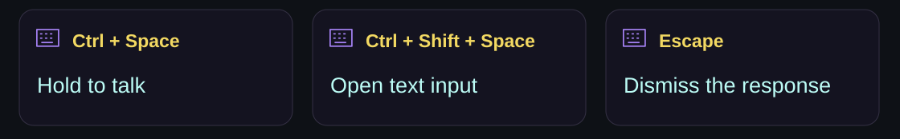</picture></p>

The tray menu provides Ask, Pause/Resume, Settings, and Quit. Screen sharing is off by default: text questions have a per-question checkbox; voice questions use the explicit Settings preference. Settings also control spoken responses and reduced motion, and offer a read-only local runtime/model check. Pause cancels capture and active turns; resuming does not automatically record.

The separate [accounts service](WhisperAccounts/README.md) implements Google-verified owner administration and complimentary lifetime grants. It has local automated security coverage, but is not deployed or wired into desktop commercial enforcement. Google OAuth configuration, production hosting, billing webhooks, desktop authentication, and independent security review remain launch gates.

##  Documentation

Start with the [documentation index](docs/README.md), or choose a path below.

<p align="center"><a href="docs/01_PRODUCT_VISION.md">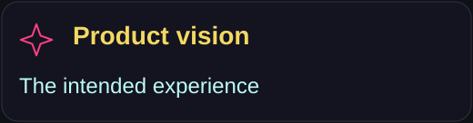</a> <a href="docs/02_CURRENT_STATE_AND_GAPS.md">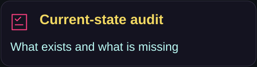</a> <a href="docs/03_PRODUCT_REQUIREMENTS.md">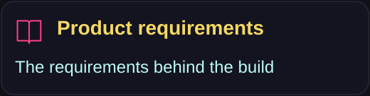</a> <a href="docs/04_TARGET_ARCHITECTURE.md">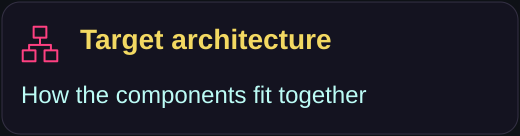</a> <a href="docs/14_EXECUTION_ROADMAP.md">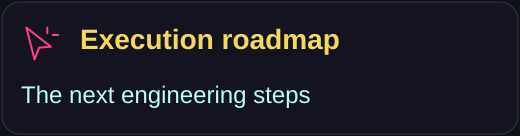</a> <a href="docs/15_DEFINITION_OF_DONE.md">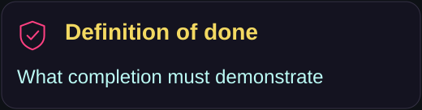</a></p>

<details>
<summary><strong>Intended product experience and boundaries</strong></summary>

The intended experience is a Windows expert beside the user: voice or text questions, grounded screen guidance, safe delegated tasks, and a choice of local or cloud processing where supported. Installing without manually configuring Python, model servers or API keys is a product goal, not the current developer setup.

Whisper is not intended to bypass Windows security, silently record users, infer exact click coordinates without grounding, or ship unrestricted autonomous actions before they are reliable.

</details>

<details>
<summary><strong>Engineering principles</strong></summary>

1. Never label a roadmap item complete until its acceptance criteria pass.
2. Prefer semantic Windows UI Automation actions over coordinate clicks.
3. Follow the minimum confirmation policy for consequential local and external actions.
4. Treat screen content as untrusted input and defend against prompt injection.
5. Maintain a useful cloud fallback for computers that cannot run local models well when the selected processing mode permits cloud use.
6. Measure latency, grounding accuracy, task success, crash rate, and retention.

</details>

<details>
<summary><strong>Repository hygiene and verification</strong></summary>

Vision installation versus inference verification, monitor testing, and remaining
desktop account/signing gates are documented in
[the verification guide](docs/23-vision-and-desktop-verification.md).

Git is initialized on `main`. Generated `bin/` and `obj/` files, the local `.dotnet/` installation, installers, downloaded model weights, logs, databases, and secrets are ignored. Existing local artifacts may remain on disk but must never be committed; third-party binaries still need a verified acquisition and license-record process before release.


</details>

<p><picture><source media="(max-width: 600px)" srcset="assets/readme/closing-mobile.svg"/>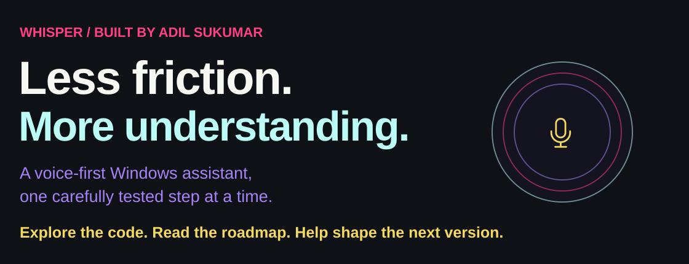</picture></p>

<p align="center"><a href="https://github.com/adilsukumar/Whisper-for-Windows/issues">Discuss an idea</a> · <a href="docs/14_EXECUTION_ROADMAP.md">Read the roadmap</a> · <a href="https://www.adilsukumar.xyz/">Meet the builder</a></p>
